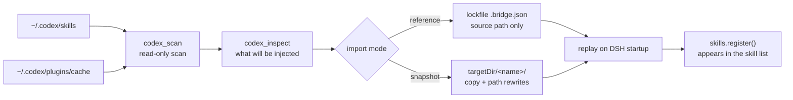

<p align="center">
  <a href="./README.md"></a>
  <a href="./README.en.md"></a>
</p>

<p align="center">
  <a href="https://github.com/DanceElephant/dsh-codex-bridge/actions/workflows/ci.yml"></a>
  
  
  <a href="https://github.com/DanceElephant/dsh-codex-bridge/releases"></a>
  
</p>

<h1 align="center">dsh-codex-bridge</h1>

<p align="center">
  Move the skills you already have in Codex into DeepSeek Harness in one command.<br>
  <sub>scan · compress descriptions · record a lockfile · replay on startup — zero dependencies, imported code is never executed</sub>
</p>

---

## Contents

- [What it is](#what-it-is)
- [What it fixes](#what-it-fixes)
- [How it works](#how-it-works)
- [Install](#install)
- [Five-minute walkthrough](#five-minute-walkthrough)
- [Two import modes](#two-import-modes-reference-vs-snapshot)
- [How a description gets down to 220 characters](#how-a-description-gets-down-to-220-characters)
- [The six tools](#the-six-tools)
- [CLI](#cli)
- [Layout and lockfile](#layout-and-lockfile)
- [Configuration](#configuration)
- [Safety boundaries](#safety-boundaries)
- [Troubleshooting](#troubleshooting)
- [Limitations](#limitations)
- [Development](#development)
- [License](#license)

## What it is

Your Codex skills live in `~/.codex/skills` (plus the plugin skills under `~/.codex/plugins/cache`). They are invisible to DeepSeek Harness (DSH), which reads its own skill directory. **This plugin is the bridge between the two.**

Install it once and then, from inside DSH:

- scan, inspect and import those skills — imported ones show up in the DSH skill list and the model loads them on demand, like any native skill;
- descriptions are compressed to fit DSH's prompt budget, so a 900-character skill description does not eat your context every session;
- you can tell when upstream changed or vanished, and undo an import cleanly.

It never executes an imported skill: scripts are listed for your information, bodies are only read and registered.

In one sentence: **skills you installed in Codex, without reinstalling them in DSH.**

### Who it is for

- People who use both Codex and DSH and do not want two copies of the same skill;
- Anyone with a pile of Codex plugin skills (docs, PDF, spreadsheets, presentations, browser automation) they want in DSH;
- People who care about context budget.

### Who it is not for

- DSH-only users with no `~/.codex` directory — scanning simply reports that the root is missing, harmlessly;
- Anyone who wants to run the Codex agent itself — this moves **skill files**, not the Codex runtime.

## What it fixes

Codex and DSH skills share nearly the same format: a `SKILL.md` with YAML frontmatter. Two things still block a straight copy:

| Problem | What happens | What this plugin does |
| --- | --- | --- |
| **Descriptions are long** | Codex `description` fields are retrieval-oriented prose, 900–1500 characters in real skills. The skill catalog is injected into every session, so copying them verbatim eats a large slice of the prompt | Compress to one trigger-style sentence (default ≤ 220 code points), keeping platform and tool names as keywords |
| **Paths are hard-coded** | Skill bodies often hard-code `${CODEX_HOME:-$HOME/.codex}/skills/<name>/...`, so resources break in a new location | `snapshot` mode copies the skill and rewrites five path spellings in the copy, keeping upstream `LICENSE`/`NOTICE` |

A real compression, from this machine's `agent-reach` skill (921 characters → 208):

```text
before (921 chars, excerpt):
MUST USE when user wants to 调研/research/搜索/search/查/找/look up anything on the internet
— e.g. 全网调研 X / 帮我调研一下 X / 查一下 X / 搜搜 X / 看看大家怎么评价 X / X 上有什么讨论 …
(another 800-odd characters follow: platform list, URL rules, output format …)

after (208 chars, full output; line breaks are cosmetic):
MUST USE when user wants to 调研/research/搜索/search/查/找/look up anything on the internet
— e.g. 全网调研 X / 帮我调研一下 X / 查一下 X / 搜搜 X / 看看大家怎么评价 X / X 上有什么讨论
/ research this topic。；小红书；B站；bilibili；推特；Twitter；YouTube
```

Trigger sentences come first (that is what the model matches on), platform keywords last (that is what retrieval matches on).

## How it works



Six stages:

1. **Scan** — find importable skills; record hash, file count, script list, raw description length;
2. **Inspect** — parse the frontmatter and show the first 500 characters of the body that will actually be injected;
3. **Plan** — `dryRun` by default: a plan, no writes; name conflicts are resolved here;
4. **Compress** — fit the description into the budget; idempotent (short enough descriptions pass through unchanged);
5. **Write** — update the lockfile atomically; `snapshot` additionally copies and rewrites paths;
6. **Replay** — on every DSH startup the lockfile entries are registered as skills. The description comes from the lockfile (upstream description edits cannot shift an injected catalog), while the body is re-read from disk (upstream body fixes take effect immediately).

## Install

The plugin is a DSH **bundle**: install it into a profile, then restart DSH.

### Option 1 — one command (recommended)

```bash
dsh plugin add https://github.com/DanceElephant/dsh-codex-bridge/releases/download/v0.1.1/dsh-codex-bridge-0.1.1.tgz
```

Restart DSH afterwards. This writes the package into the profile's `dependencies` and `dsh.profile.bundles`; no manual registration.

### Option 2 — plugin market

The plugin has been submitted to the [DSH plugin market](https://awesome-dsh-plugin.com) (entry PR [#15734](https://github.com/awesome-dsh-plugin/awesome-dsh-plugin/pull/15734)). Once merged, search `codex-bridge` under the skill category and click install. **Before the merge, use option 1.**

### Option 3 — manual install into a profile

```bash
cd /path/to/dsh-codex-bridge
npm pack                                   # produces dsh-codex-bridge-0.1.1.tgz

cd ~/.dsh/profiles/<your profile>
npm i /path/to/dsh-codex-bridge-0.1.1.tgz
```

If plugins already in the profile have peer conflicts (for example `dsh-univer-office` and `@perrylink/dsh-github` disagreeing about `@deepseek-ai/dsh-llm`), `npm i` reports `ERESOLVE`. That is a pre-existing profile problem, unrelated to this plugin (zero dependencies, no peers); add `--legacy-peer-deps` to get past it.

Then append to that profile's `cordis.patch.yml`:

```yaml
- insert:
    - id: dsh-codex-bridge
      name: dsh-codex-bridge
      config: {}
```

Make sure `dsh.profile.bundles` in the profile's `package.json` contains `"dsh-codex-bridge"`, then restart DSH.

### CLI only, no bundle

```bash
node bin/bridge.mjs scan
```

## Five-minute walkthrough

After installing and restarting, in DSH. Every tool returns `{ ok, ...fields, data }`.

**① Scan**

```json
codex_scan({ "exclude": ["template-creator"] })
```

Real output from this machine:

```text
agent-reach            standalone               9 files    921 chars
playwright             standalone               9 files    209 chars
visualize              plugin/visualize         43 files   309 chars
documents              plugin/documents         80 files   313 chars
pdf                    plugin/pdf               4 files    222 chars

9 importable skills
skipped: github  MCP_ONLY  MCP config only, no skills/
```

**② Inspect** — what the model will actually read:

```json
codex_inspect({ "name": "playwright" })
```

Look at `willInject` (first 500 body characters) and `scriptFiles` (scripts that are named but never executed).

**③ Plan** — nothing is written:

```json
codex_import({ "names": ["playwright"] })
```

`planned[]` shows the target name, mode, compressed description and whether it is already imported.

**④ Import** — explicit confirmation writes:

```json
codex_import({ "names": ["playwright"], "confirm": true, "onConflict": "prefix" })
```

**⑤ Restart DSH** — the skill now appears in the skill list with its compressed description.

**⑥ Maintenance**

```json
codex_list({})                                       // did upstream change? (re-hashes)
codex_doctor({ "fix": false })                       // stale paths / over budget / missing binaries
codex_remove({ "names": ["playwright"], "purge": false })
```

## Two import modes: reference vs snapshot

| | `reference` (default) | `snapshot` |
| --- | --- | --- |
| Where files live | Not copied; the lockfile stores `sourcePath` | Copied to `~/.dsh/codex-bridge/<skill-name>/` |
| Upstream edits | Body reflects the new version on next startup | Requires re-import |
| Upstream deleted | Warned and skipped at startup | Copy still works |
| Best for | Most skills (no hard-coded paths) | Bodies containing `${CODEX_HOME:-$HOME/.codex}/skills/<name>` and friends |
| Disk use | none | size of the skill dir (skips `.git`, `node_modules`, `assets/` files >1 MiB) |

`snapshot` rewrites these five spellings in the copy so they point at the new directory:

```text
${CODEX_HOME:-$HOME/.codex}/skills/<name>      $CODEX_HOME/skills/<name>
$HOME/.codex/skills/<name>                     ~/.codex/skills/<name>
<absolute source directory>
```

Rewrites only touch text files ≤512 KiB and every replacement is recorded in the lockfile's `rewrites`, so it is auditable.

## How a description gets down to 220 characters

Not a blunt cut — truncating would drop the "when to use me" sentence and break retrieval. `lib/describe.mjs`:

1. **Clean**: strip code fences, backticks, images, links, URLs, heading marks; squeeze whitespace;
2. **Keep trigger sentences**: sentences containing `use when` / `must use` / `使用时机` / `用于` / `当…时` / `适合…场景` / `triggers on` move to the front;
3. **Reserve keywords**: platform words (小红书, B站, GitHub…), backticked identifiers and capitalized product names get at most `min(keyword length, 45% × budget)`, up to 6;
4. **Fill**: spend the rest of the budget on whole sentences, cutting at clause boundaries with `…`, joined by `；`.

Length is measured in Unicode code points; the default cap is **220** (`maxDescription`). A description that already fits passes through unchanged, so repeated imports are safe.

## The six tools

| Tool | Purpose | Parameters | Key returns |
| --- | --- | --- | --- |
| `codex_scan` | Read-only scan | `root`, `include[]`, `exclude[]` | `total`, `items[]` (with `alreadyImported`), `problems[]` |
| `codex_inspect` | Inspect one skill | `name` or `path` | `willInject` (500 chars), `scriptFiles[]`, `importable` |
| `codex_import` | Import and record | `names[]`, `mode`, `onConflict`, `dryRun`, `confirm` | `planned[]`, `applied[]`, `failed[]` |
| `codex_list` | Imported entries + upstream diff | none | `items[]` (with `upstreamChanged`, `upstreamMissing`) |
| `codex_remove` | Unregister | `names[]`, `purge` | `removed[]`, `purged[]` |
| `codex_doctor` | Health check | `root`, `fix` | `missingBinaries[]`, `stalePaths[]`, `overBudget[]`, `healthy` |

Details:

- `mode`: `reference` (default) or `snapshot`;
- `onConflict`: `prefix` (default — a clash becomes `codex-<name>`, then `codex-<name>-2`, …), `skip`, `overwrite`;
- `dryRun` defaults to `true`: **nothing is written without `confirm: true`**;
- `purge: true` deletes only snapshot copies inside `targetDir`; a `reference` source directory is never deleted.

## CLI

```text
bridge scan    [--root DIR] [--target DIR] [--json]
bridge inspect <name|path> [--root DIR] [--json]
bridge import  <name...> [--mode reference|snapshot] [--on-conflict prefix|skip|overwrite]
                         [--dry-run] [--yes] [--root DIR] [--target DIR] [--json]
bridge list    [--target DIR] [--json]
bridge remove  <name...> [--purge] [--target DIR] [--json]
bridge doctor  [--fix] [--root DIR] [--target DIR] [--json]
```

- `import` is a dry run unless you pass `--yes`;
- `--json` prints one line of JSON;
- exit codes: `0` success · `1` usage error · `2` execution or partial failure.

## Layout and lockfile

```text
~/.codex/                                  # codexRoot: read-only, never written
├── skills/<name>/SKILL.md                 #   standalone skills
└── plugins/cache/<market>/<plugin>/<ver>/ #   plugin skills
    ├── .codex-plugin/plugin.json
    └── skills/<name>/SKILL.md

~/.dsh/codex-bridge/                       # targetDir: the only writable location
├── .bridge.json                           #   lockfile (version 1, mode 0600)
└── <skill-name>/                          #   snapshot copies only
```

Per-entry lockfile fields: `name` / `sourceName`, `sourcePath` / `sourceKind` / `sourceVersion`, `hash` (sha256 of the upstream directory, used to detect drift), `mode`, `description` / `longDescription`, `files`, `importedAt`, and optionally `pluginName` and `rewrites`.

Writes are atomic: temp file `0600` → `fsync` → `rename`. A batch that fails halfway leaves earlier entries valid.

## Configuration

```yaml
- insert:
    - id: dsh-codex-bridge
      name: dsh-codex-bridge
      config:
        maxDescription: 220
```

| Field | Default | Meaning |
| --- | --- | --- |
| `codexRoot` | `~/.codex` | Read-only Codex root |
| `targetDir` | `~/.dsh/codex-bridge` | Lockfile and snapshot location |
| `maxDescription` | `220` | Description budget injected into DSH (Unicode code points) |

An empty config is fine, and a broken config **cannot stop DSH from booting**: each phase is wrapped, failures only log a `[codex-bridge]` warning.

## Safety boundaries

- `codexRoot` is **read-only**; the only writable location is `targetDir`, and escapes raise `PATH_ESCAPE` (including symlink escapes);
- **no imported code is ever executed** — `scriptFiles` is informational, `doctor` only checks whether those binaries are on PATH;
- **no network access**, zero runtime dependencies, plain ESM, no build step;
- every delete (`remove --purge`, `overwrite` cleanup, `doctor --fix`) verifies the target is inside `targetDir` first;
- `snapshot` preserves upstream `LICENSE`/`NOTICE` and records every rewrite.

## Troubleshooting

**Scan returns zero / "codexRoot does not exist"** — pass `codexRoot` or `--root` if Codex lives elsewhere.

**A plugin I installed does not show up** — plugins with only MCP configuration produce no skill entries. They are reported in `problems[]` as `MCP_ONLY`; a plugin with a manifest but no `skills/` is `NO_SKILLS`. "Nothing to import" and "plugin missing" are deliberately different answers.

**Imported, but no skill in DSH** — replay happens at startup: **restart DSH**. If it is still absent, run `codex_doctor` and check `replayable` (over-budget descriptions or a deleted `SKILL.md` cause a skip; the log carries a `[codex-bridge]` warning).

**The skill name changed** — the default conflict policy is `prefix`, so the new name is `codex-<original>`. Use `onConflict: "overwrite"` or remove the old entry first.

**The description got shorter / ends with `…`** — that is the compression. Raise `maxDescription` if you want more, at the cost of a longer prompt every session.

**Upstream changed** — `reference` mode: the body follows upstream automatically, the description keeps its imported value (re-import to refresh it). `snapshot` mode: re-import.

**doctor reports missing binaries** — the skill names tools such as `playwright-cli`, `pandoc`, `ffmpeg`, `magick`, `pdftotext`, `jq`, `rg`, `python3`, `node`, `npx`, `git` that are not on PATH. The plugin only reports; it never installs anything.

## Limitations

- Only the `SKILL.md` layer is moved. Codex-specific `agents/openai.yaml` and `.app.json` are not translated;
- name conflicts are judged on `name` alone; same-named skills from two plugins are handled by `onConflict`;
- `snapshot` rewrites only the five path spellings above; other hard-coded absolute paths are left alone;
- compression is heuristic: a very long description with no trigger sentence is cut at a clause boundary;
- with several plugin versions present, the highest version wins (`1.10.0 > 1.2.3`); hash-like directories sort last;
- **`autoReplay` is not implemented**: earlier docs mentioned the switch, but the current behaviour is "always replay on startup". To stop injecting temporarily, use `codex_remove` or uninstall the plugin.

## Development

```bash
npm test                 # node:test, 74 cases (1 real-data case skipped unless CODEX_BRIDGE_REAL=1)
npm run coverage:check   # lib/ line coverage gate ≥ 85% (currently 91.79%)
npm run smoke            # lifecycle smoke: idempotent re-apply, clean dispose
```

CI runs on Node 20 / 22 / 24; the coverage assertion runs on Node 24. Modules:

```text
lib/index.mjs      # bundle entry: register tools, replay, dispose
lib/tools.mjs      # the six tool definitions and argument validation
lib/discover.mjs   # scanning: two sources, version pick, hash, skip reasons
lib/importer.mjs   # importing: naming/conflicts, reference vs snapshot, lock entries
lib/describe.mjs   # description compression
lib/lockfile.mjs   # lockfile reads and atomic writes
lib/doctor.mjs     # health check
lib/frontmatter.mjs lib/manifest.mjs lib/paths.mjs  # parsing, manifests, path safety
```

## License

[MIT](./LICENSE)

Related: [DeepSeek Harness](https://github.com/deepseek-ai/dsh) · [DSH plugin market](https://awesome-dsh-plugin.com) ([repo](https://github.com/awesome-dsh-plugin/awesome-dsh-plugin)) · [Codex](https://github.com/openai/codex)
