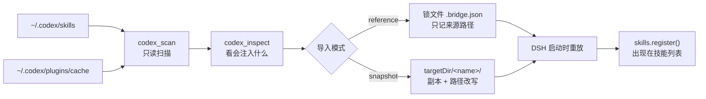

<p align="center">
  <a href="./README.md"></a>
  <a href="./README.en.md"></a>
</p>

<p align="center">
  <a href="https://github.com/DanceElephant/dsh-codex-skill-bridge/actions/workflows/ci.yml"></a>
  
  
  <a href="https://github.com/DanceElephant/dsh-codex-skill-bridge/releases"></a>
  
</p>

<h1 align="center">dsh-codex-skill-bridge</h1>

<p align="center">
  把本机 Codex 的技能，一条命令搬进 DeepSeek Harness。<br>
  <sub>扫描 · 压缩描述 · 登记锁文件 · 启动自动重放 —— 零依赖，不执行任何被导入的代码</sub>
</p>

---

## 目录

- [这是什么](#这是什么)
- [它解决什么问题](#它解决什么问题)
- [工作原理](#工作原理)
- [安装](#安装)
- [5 分钟上手](#5-分钟上手)
- [两种导入模式](#两种导入模式reference-与-snapshot)
- [描述是怎么压到 220 字的](#描述是怎么压到-220-字的)
- [六个工具](#六个工具)
- [CLI](#cli)
- [目录布局与锁文件](#目录布局与锁文件)
- [配置项](#配置项)
- [安全边界](#安全边界)
- [排错与常见问题](#排错与常见问题)
- [限制与已知问题](#限制与已知问题)
- [开发与测试](#开发与测试)
- [许可证](#许可证)

## 这是什么

你在 Codex 里用得好好的技能（`~/.codex/skills` 里那些 `SKILL.md`，以及插件市场装下来的插件技能），在 DeepSeek Harness（下面简称 DSH）里是读不到的——两套工具各有各的技能目录。

**这个插件就是那座桥。** 装一次，之后：

- DSH 里能直接扫描、检视、导入这些技能，导入过的技能会出现在 DSH 的技能列表里，和原生技能一样被模型按需加载；
- 技能的「描述」会按 DSH 的提示词预算压缩好，不会把上下文撑爆；
- 上游改了、删了，你能一条命令查出来；不想用了，也能干净地撤掉。

它自己**不执行**任何被导入的技能：脚本只是被列出来给你看，正文只是被读取和登记。

一句话：**Codex 装过的技能，DSH 里不用重装一遍。**

### 适合谁

- 同时在用 Codex 和 DSH，不想维护两份同名技能；
- Codex 里攒了十几个插件技能（文档、PDF、表格、演示、浏览器自动化……），想在 DSH 里复用；
- 在意上下文预算，不想让 900 字一条的技能描述常驻系统提示。

### 不适合谁

- 只用 DSH、没有 `~/.codex` 目录的人——扫描会直接告诉你「根目录不存在」，没有副作用，但也没什么可导的；
- 想要「把 Codex 整个 agent 跑起来」的人——本插件搬的是**技能文件**，不是 Codex 运行时。

## 它解决什么问题

Codex 和 DSH 的技能格式几乎一样，都是带 YAML frontmatter 的 `SKILL.md`。真正卡人的是两处：

| 硬伤 | 具体表现 | 本插件怎么做 |
| --- | --- | --- |
| **描述太长** | Codex 的 `description` 是给检索用的长文，真实样本 900–1500 字。每个会话的技能目录都要进系统提示词，直接搬会把上下文吃掉一大块 | 按预算压成一句触发式描述（默认 ≤ 220 码点），保留平台名、工具名等检索关键词 |
| **目录写死** | 技能正文里常写死 `${CODEX_HOME:-$HOME/.codex}/skills/<name>/...`，换个目录资源就找不到 | `snapshot` 模式复制一份副本，把 5 种路径写法改写到新位置，并保留上游 `LICENSE`/`NOTICE` |

真实压缩效果（本机 `agent-reach` 技能，原文 921 字 → 压缩后 208 字）：

```text
原文（921 字，节选）：
MUST USE when user wants to 调研/research/搜索/search/查/找/look up anything on the internet
— e.g. 全网调研 X / 帮我调研一下 X / 查一下 X / 搜搜 X / 看看大家怎么评价 X / X 上有什么讨论 …
（后面还有 800 多字：平台清单、URL 处理规则、输出格式……）

压缩后（208 字，全文；换行仅排版）：
MUST USE when user wants to 调研/research/搜索/search/查/找/look up anything on the internet
— e.g. 全网调研 X / 帮我调研一下 X / 查一下 X / 搜搜 X / 看看大家怎么评价 X / X 上有什么讨论
/ research this topic。；小红书；B站；bilibili；推特；Twitter；YouTube
```

触发句在最前（模型靠它判断「什么时候该用」），平台词在最后（检索靠它们命中）。

## 工作原理



六步：

1. **扫描**：找出所有可导入的技能，算 hash、文件数、脚本清单、原始描述长度；
2. **检视**：解析 frontmatter，给出「真正会被注入的正文前 500 字符」，导入前先看清楚；
3. **预演**：默认 `dryRun`，只回计划、不写盘，重名怎么办也在这里定；
4. **压缩**：把描述压进预算，幂等（已经够短就原样保留）；
5. **落盘**：写锁文件（原子写），`snapshot` 模式额外复制并改写路径；
6. **重放**：DSH 每次启动读锁文件，把条目重新注册成技能。描述取锁里的压缩值（上游改描述不会让已注入的目录漂移），正文每次从磁盘现读（上游修正文立刻生效）。

## 安装

插件是 DSH 的 **bundle**，装进 profile 后重启 DSH 生效。

### 方式一：一行命令（推荐）

```bash
dsh plugin add https://github.com/DanceElephant/dsh-codex-skill-bridge/releases/download/v0.2.0/dsh-codex-skill-bridge-0.2.0.tgz
```

然后重启 DSH。这一步会把包写进 profile 的 `dependencies` 和 `dsh.profile.bundles`，注册不需要你手改配置。

### 方式二：插件市场

本插件已在 [DSH 插件市场](https://awesome-dsh-plugin.com) 提交条目（分类：技能，搜索 `codex-skill-bridge`）。条目合并前，请用方式一的一行命令安装。

### 方式三：手工装进 profile

```bash
cd /path/to/dsh-codex-skill-bridge
npm pack                                   # 生成 dsh-codex-skill-bridge-0.2.0.tgz

cd ~/.dsh/profiles/<你的 profile>
npm i /path/to/dsh-codex-skill-bridge-0.2.0.tgz
```

如果 profile 里已有插件之间存在 peer 冲突（例如 `dsh-univer-office` 与 `@perrylink/dsh-github`
对 `@deepseek-ai/dsh-llm` 的版本要求不一致），`npm i` 会报 `ERESOLVE`。那是 profile 既有问题，
与本插件无关（本插件零依赖、无 peer 要求），可加 `--legacy-peer-deps` 安装。

再在该 profile 的 `cordis.patch.yml` 追加：

```yaml
- insert:
    - id: dsh-codex-skill-bridge
      name: dsh-codex-skill-bridge
      config: {}
```

并确认 profile 的 `package.json` 里 `dsh.profile.bundles` 含 `"dsh-codex-skill-bridge"`，然后重启 DSH。

### 只用 CLI，不装 bundle

不想动 DSH 配置也能用命令行验证：

```bash
node bin/bridge.mjs scan
```

## 5 分钟上手

装好并重启后，在 DSH 里让模型（或你自己）执行以下流程。每条命令的返回都是 `{ ok, ...字段, data }` 结构。

**① 扫描：有什么可导入的**

```json
codex_scan({ "exclude": ["template-creator"] })
```

返回类似（本机真实输出）：

```text
agent-reach            standalone               9 文件    921 字
playwright             standalone               9 文件    209 字
visualize              plugin/visualize         43 文件   309 字
documents              plugin/documents         80 文件   313 字
pdf                    plugin/pdf               4 文件    222 字

合计 9 个可导入技能
跳过：github  MCP_ONLY  只有 MCP 配置，没有 skills/
```

**② 检视：导入后模型会读到什么**

```json
codex_inspect({ "name": "playwright" })
```

重点看 `willInject`（正文前 500 字符）和 `scriptFiles`（会被点名、但绝不会被执行的脚本）。

**③ 预演：不写任何文件**

```json
codex_import({ "names": ["playwright"] })
```

返回 `planned[]`：目标名、模式、压缩后的描述、是否已导入过。确认无误再落库。

**④ 导入：显式确认才写盘**

```json
codex_import({ "names": ["playwright"], "confirm": true, "onConflict": "prefix" })
```

**⑤ 重启 DSH，技能出现**

重启后，导入的技能会出现在技能列表里（描述是压缩后的那句），模型可以在合适的场景自动加载。

**⑥ 日常维护**

```json
codex_list({})                        // 上游变了没有？（重新算 hash）
codex_doctor({ "fix": false })        // 体检：路径失效 / 描述超预算 / 缺命令行工具
codex_remove({ "names": ["playwright"], "purge": false })   // 注销
```

## 两种导入模式：reference 与 snapshot

| | `reference`（默认） | `snapshot` |
| --- | --- | --- |
| 技能文件放哪 | 不复制，锁文件记 `sourcePath` 指向上游 | 复制到 `~/.dsh/codex-skill-bridge/<skill-name>/` |
| 上游改动 | 下次启动正文即为新版 | 要重新导入才更新 |
| 上游被删 | 启动时告警并跳过该条 | 副本仍在，照常可用 |
| 适合 | 绝大多数技能（不写死路径） | 正文里带 `${CODEX_HOME:-$HOME/.codex}/skills/<name>` 这类硬编码 |
| 磁盘占用 | 0 | 技能目录大小（跳过 `.git`、`node_modules`、`assets/` 下 >1 MiB 的文件） |

`snapshot` 会改写副本里这 5 种写法，使其指向新目录：

```text
${CODEX_HOME:-$HOME/.codex}/skills/<name>      $CODEX_HOME/skills/<name>
$HOME/.codex/skills/<name>                     ~/.codex/skills/<name>
<源目录的绝对路径>
```

改写只发生在 ≤512 KiB 的文本文件里，每一处改写都记进锁文件的 `rewrites`，可以审计。

## 描述是怎么压到 220 字的

不是硬截断——直接砍会把「什么时候该用」砍掉，技能就检索不到了。`lib/describe.mjs` 的规则：

1. **清理**：去掉代码块、反引号、图片、链接、URL、标题符号，压掉多余空白；
2. **保触发句**：含 `use when` / `must use` / `使用时机` / `用于` / `当…时` / `适合…场景` / `triggers on` 的句子排到最前；
3. **留关键词**：为平台词（小红书、B站、GitHub…）、反引号里的标识符、首字母大写的产品名预留最多 `min(关键词长度, 45% × 预算)`，最多 6 个；
4. **填正文**：剩余预算按整句填，到子句边界截断并补 `…`，各句用 `；` 连接。

长度按 Unicode 码点算，默认上限 **220**（`maxDescription` 可调）。清理后本来就不超预算的描述原样保留，所以重复执行是安全的。

## 六个工具

| 工具 | 作用 | 主要参数 | 关键返回 |
| --- | --- | --- | --- |
| `codex_scan` | 只读扫描可导入技能 | `root`、`include[]`、`exclude[]` | `total`、`items[]`（含 `alreadyImported`）、`problems[]` |
| `codex_inspect` | 检视单个技能 | `name` 或 `path` | `willInject`（前 500 字符）、`scriptFiles[]`、`importable` |
| `codex_import` | 导入并登记 | `names[]`、`mode`、`onConflict`、`dryRun`、`confirm` | `planned[]`、`applied[]`、`failed[]` |
| `codex_list` | 已导入项 + 上游比对 | 无 | `items[]`（含 `upstreamChanged`、`upstreamMissing`） |
| `codex_remove` | 注销 | `names[]`、`purge` | `removed[]`、`purged[]` |
| `codex_doctor` | 体检 | `root`、`fix` | `missingBinaries[]`、`stalePaths[]`、`overBudget[]`、`healthy` |

参数细节：

- `mode`：`reference`（默认）或 `snapshot`；
- `onConflict`：`prefix`（默认，撞名变 `codex-<名字>`，再撞 `codex-<名字>-2`…）、`skip`、`overwrite`；
- `dryRun` 默认 `true`——**不传 `confirm: true` 绝不写盘**；
- `purge: true` 只删 `targetDir` 内的 snapshot 副本，`reference` 的上游目录永远不会被删。

## CLI

和工具一一对应，适合脚本与 CI：

```text
bridge scan    [--root DIR] [--target DIR] [--json]
bridge inspect <name|path> [--root DIR] [--json]
bridge import  <name...> [--mode reference|snapshot] [--on-conflict prefix|skip|overwrite]
                         [--dry-run] [--yes] [--root DIR] [--target DIR] [--json]
bridge list    [--target DIR] [--json]
bridge remove  <name...> [--purge] [--target DIR] [--json]
bridge doctor  [--fix] [--root DIR] [--target DIR] [--json]
```

- `import` 默认 dry-run，加 `--yes` 才写；
- `--json` 输出单行 JSON；
- 退出码：`0` 成功 · `1` 用法错误 · `2` 执行失败或部分失败。

典型流程：

```bash
bridge scan                                  # 看有哪些技能可导入
bridge inspect playwright                    # 看 willInject 正文前 500 字符
bridge import playwright --dry-run           # 预演
bridge import playwright --yes                # 真写
bridge list                                  # 已导入 + 上游是否变化
bridge doctor                                # 体检（缺失二进制 / 失效路径 / 超预算）
```

## 目录布局与锁文件

```text
~/.codex/                                  # codexRoot：只读，绝不写入
├── skills/<name>/SKILL.md                 #   独立技能（kind: standalone）
└── plugins/cache/<market>/<plugin>/<ver>/ #   插件技能（kind: plugin）
    ├── .codex-plugin/plugin.json
    └── skills/<name>/SKILL.md

~/.dsh/codex-skill-bridge/                       # targetDir：唯一写入位置
├── .bridge.json                           #   锁文件（版本 1，权限 0600）
└── <skill-name>/                          #   仅 snapshot 模式：副本
```

锁文件里每条记录：

| 字段 | 含义 |
| --- | --- |
| `name` / `sourceName` | DSH 里的名字 / Codex 里的原名 |
| `sourcePath` / `sourceKind` / `sourceVersion` | 来源目录、`standalone` 或 `plugin`、插件版本 |
| `hash` | 导入时上游目录的 sha256 摘要，用于判断「上游变了没有」 |
| `mode` | `reference` 或 `snapshot` |
| `description` / `longDescription` | 压缩后的描述 / 原始描述 |
| `files` / `importedAt` | 文件数 / 导入时间 |
| `pluginName` / `rewrites` | 插件名（如有）/ snapshot 的路径改写记录 |

写入是原子的：临时文件 `0600` → `fsync` → `rename`。批量导入中途失败，已成功的条目仍然有效。

## 配置项

在 profile 的 `cordis.patch.yml` 里传：

```yaml
- insert:
    - id: dsh-codex-skill-bridge
      name: dsh-codex-skill-bridge
      config:
        maxDescription: 220
```

| 字段 | 默认 | 说明 |
| --- | --- | --- |
| `codexRoot` | `~/.codex` | 只读的 Codex 根目录 |
| `targetDir` | `~/.dsh/codex-skill-bridge` | 锁文件与 snapshot 副本的存放处 |
| `maxDescription` | `220` | 注入 DSH 的描述预算（按 Unicode 码点计） |
| `autoReplay` | `true` | 启动时是否重放锁文件里的导入项。设 `false` 则只注册工具、不注入技能（锁文件原样保留） |

插件自带空配置，配置写错也**不会让 DSH 启动失败**——每个阶段独立 try/catch，出错只打一条 `[codex-skill-bridge]` 警告。

## 安全边界

- 对 `codexRoot` **只读**；唯一写入位置是 `targetDir`，越界会抛 `PATH_ESCAPE`（含符号链接逃逸检查）；
- **绝不执行**被导入技能里的任何脚本——`scriptFiles` 只做展示，`doctor` 只检查它们在不在 PATH；
- **无网络请求**，零运行时依赖，纯 ESM，无构建步骤；
- 删除操作（`remove --purge`、`overwrite` 清旧副本、`doctor --fix`）都会先校验目标确实在 `targetDir` 内；
- `snapshot` 保留上游 `LICENSE`/`NOTICE`，路径改写记录完整留档。

## 排错与常见问题

**扫描结果为 0，或提示「根目录不存在」**
`~/.codex` 不在默认位置时传 `codexRoot`/`--root`。目录存在但没有技能，检查是否只在 `plugins/cache` 里且没装技能。

**明明装了 GitHub 插件，扫描却没它**
只有 MCP 配置、没有 `skills/` 的插件不会产生技能条目，扫描会把它记在 `problems[]` 里，码是 `MCP_ONLY`；有清单但没 `skills/` 是 `NO_SKILLS`。这是设计如此：「没有技能可导」和「插件不存在」是两件事。

**导入成功了，DSH 里没看到技能**
重放只在启动时发生——**重启 DSH**。若仍没有，跑 `codex_doctor`，看条目是否 `replayable`（描述超预算、`SKILL.md` 被删都会导致跳过，日志里有 `[codex-skill-bridge]` 警告）。

**技能名被改了**
撞名时默认策略是 `prefix`，新名字是 `codex-<原名>`。想保留原名就用 `onConflict: "overwrite"` 或先 `codex_remove` 旧的。

**描述变短了 / 结尾有 `…`**
正常，这是压缩结果。想保留更长描述就调大 `maxDescription`，代价是每个会话的提示词更长。

**上游更新了，要做什么**
`reference` 模式：正文自动跟着上游走，描述保持导入时的压缩值；想让描述也更新，重新导入一次。`snapshot` 模式：必须重新导入。

**doctor 报缺命令行工具**
技能正文里点名的二进制（`playwright-cli`、`pandoc`、`ffmpeg`、`magick`、`pdftotext`、`jq`、`rg`、`python3`、`node`、`npx`、`git`）不在 PATH。插件只是提示，不会安装任何东西。

## 限制与已知问题

- 只搬 `SKILL.md` 这一层。Codex 专有的 `agents/openai.yaml`、`.app.json` 等不做转换；
- 重名判定只看 `name`，两个插件下的同名技能靠 `onConflict` 处理；
- snapshot 只改写上面那 5 种路径写法，硬编码的其他绝对路径不会改；
- 描述压缩是启发式的：没有触发句的超长描述会被截到子句边界；
- 多版本插件目录选版本号最大者（`1.10.0 > 1.2.3`），hash 形态的目录排最后；

## 开发与测试

```bash
npm test                 # node:test，74 个用例（1 个需 CODEX_BRIDGE_REAL=1 的真实数据用例默认跳过）
npm run coverage:check   # lib/ 行覆盖率闸门 ≥ 85%（当前 91.79%）
npm run smoke            # 生命周期冒烟：两轮 apply 幂等、dispose 无残留
```

CI 在 Node 20 / 22 / 24 上跑测试，覆盖率断言在 Node 24 上执行。模块职责：

```text
lib/index.mjs      # bundle 入口：注册工具、启动重放、dispose
lib/tools.mjs      # 6 个工具的定义与参数校验
lib/discover.mjs   # 扫描：两类来源、版本选择、hash、跳过原因
lib/importer.mjs   # 导入：命名/冲突、reference 与 snapshot、锁条目
lib/describe.mjs   # 描述压缩
lib/lockfile.mjs   # 锁文件读写（原子写）
lib/doctor.mjs     # 体检
lib/frontmatter.mjs lib/manifest.mjs lib/paths.mjs  # 解析、清单、路径安全
```

## 许可证

[MIT](./LICENSE)

相关项目：[DeepSeek Harness](https://github.com/deepseek-ai/dsh) · [DSH 插件市场](https://awesome-dsh-plugin.com)（[仓库](https://github.com/awesome-dsh-plugin/awesome-dsh-plugin)） · [Codex](https://github.com/openai/codex)
